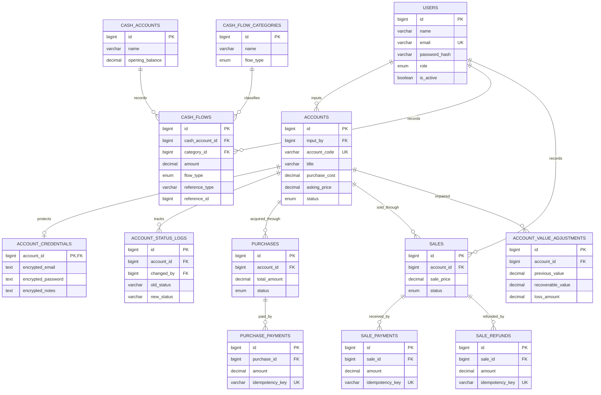

# PRD Final — ML Account Manager

**Versi:** 1.0  
**Status:** Rancangan awal siap ditinjau  
**Stack:** React + Vite + TypeScript, Go Fiber, GORM, MySQL 8.0.16+

## 1. Ringkasan Produk

ML Account Manager adalah aplikasi untuk mengelola inventaris akun
Mobile Legends, proses input dan publikasi, penjualan, arus kas, serta
kerugian akun. Katalog dapat diakses publik tanpa login. Pengelolaan
data internal memerlukan login.
### Tujuan

- Menyimpan informasi akun ML yang dibeli atau diperoleh.
- Mengelola alur draft, pemeriksaan pemilik, publikasi, reservasi, dan
penjualan.
- Melindungi kredensial Gmail dan akun ML.
- Mencatat pembelian, pembayaran aktual, penerimaan penjualan, biaya,
refund, dan kerugian.
- Menyediakan laporan saldo kas, inventaris, omzet, laba-rugi, dan
aktivitas.
### Ruang Lingkup Versi Pertama

- Login pemilik dan pengguna input.
- Role-based access control.
- Input draft akun dan review pemilik.
- Katalog publik untuk akun tersedia dan sold.
- Kontak pembelian melalui WhatsApp.
- Pencatatan pembelian dan pembayaran bertahap.
- Pencatatan penjualan dan penerimaan pembayaran.
- Cashflow, biaya, refund, dan kerugian inventaris.
- Dashboard dan laporan dasar.
- Audit log dan backup.

**Tidak termasuk versi pertama:** checkout otomatis, payment gateway,
multi-cabang, sinkronisasi dengan akun game, dan otomasi transaksi
dengan pihak ketiga.

## 2. Role dan Hak Akses

| Kemampuan | Guest | Pengguna Input | Pemilik |
| --- | --- | --- | --- |
| Melihat katalog tersedia dan sold | Ya | Ya | Ya |
| Melihat detail publik | Ya | Ya | Ya |
| Membuat draft akun | Tidak | Ya | Ya |
| Melihat seluruh draft | Tidak | Tidak | Ya |
| Melihat kredensial tersimpan | Tidak | Tidak | Ya |
| Menetapkan harga jual final | Tidak | Tidak | Ya |
| Menerbitkan akun | Tidak | Tidak | Ya |
| Mencatat penjualan | Tidak | Tidak | Ya |
| Mengelola pembayaran dan cashflow | Tidak | Tidak | Ya |
| Mengakui kerugian akun | Tidak | Tidak | Ya |
| Mengelola pengguna | Tidak | Tidak | Ya |

Pengguna input boleh mengisi kredensial pada saat membuat draft, tetapi
API tidak mengembalikan kembali nilai rahasia setelah penyimpanan. Hanya
pemilik yang memiliki endpoint khusus untuk membaca kredensial, dan
akses tersebut harus dicatat dalam audit log.
## 3. Status Akun

| Status | Makna |
| --- | --- |
| `DRAFT` | Data belum disetujui dan belum tampil di katalog. |
| `AVAILABLE` | Disetujui dan tersedia untuk ditawarkan. |
| `RESERVED` | Sedang dipesan atau menunggu konfirmasi pembelian. |
| `SOLD` | Penjualan telah dikonfirmasi sesuai kebijakan bisnis. |
| `UNSELLABLE` | Tidak dapat dijual; perlu penilaian nilai yang masih dapat dipulihkan. |
| `ARCHIVED` | Disembunyikan dari katalog aktif, histori tetap disimpan. |

Status inventaris berbeda dari status pembayaran. Transaksi penjualan
dapat berstatus `PENDING` atau `PARTIAL` sementara akun sudah
dicadangkan. Perubahan menjadi `SOLD` harus mengikuti aturan bisnis yang
disepakati, bukan sekadar perubahan teks.
## 4. Kebutuhan Fungsional

### 4.1 Katalog Publik

- Menampilkan akun `AVAILABLE` dan `SOLD`.
- Menampilkan informasi publik seperti judul, deskripsi, rank, level, jumlah skin, harga jual, dan status.
- Mendukung pencarian dan filter.
- Menyediakan tautan WhatsApp pemilik.
- Tidak pernah mengirim Gmail, password, harga beli, atau catatan internal ke endpoint publik.

### 4.2 Input dan Review Akun

- Pengguna menginput data akun, harga beli, kredensial, dan keterangan.
- Akun disimpan sebagai `DRAFT`.
- Pemilik memeriksa data, menentukan harga jual, lalu menerbitkan atau mengembalikan draft untuk revisi.
- Akun hanya tampil di katalog setelah diterbitkan.
- Perubahan status dicatat di histori.

### 4.3 Pembelian

- Harga beli dapat dicatat saat akun diinput.
- Pembayaran baru menjadi cashflow keluar ketika uang benar-benar dibayarkan.
- Mendukung pembayaran sebagian.
- Status pembelian dihitung dari jumlah pembayaran: `UNPAID`, `PARTIAL`, `PAID`, atau `CANCELLED`.

### 4.4 Penjualan

- Pemilik mencatat harga final, pembeli opsional, biaya, dan status pembayaran.
- Penerimaan kas dicatat hanya ketika pembayaran benar-benar diterima.
- Mendukung pembayaran sebagian, pembatalan, dan refund.
- Satu akun tidak boleh memiliki lebih dari satu penjualan aktif secara bersamaan.

### 4.5 Cashflow

- Mencatat pemasukan dan pengeluaran aktual.
- Mendukung beberapa sumber kas: kas tunai, rekening bank, atau dompet digital.
- Transfer antarkas tidak dihitung sebagai pendapatan atau biaya.
- Setiap transaksi yang berasal dari pembayaran harus memiliki referensi ke sumber transaksi.

### 4.6 Kerugian Akun

- Pemilik dapat menandai akun sebagai tidak dapat dijual.
- Mendukung penghapusan nilai modal penuh maupun sebagian.
- Nilai yang masih dapat dipulihkan ditentukan pemilik dan disertai alasan.
- Pengakuan kerugian tidak membuat pengeluaran kas kedua kali.
- Penyesuaian nilai disimpan sebagai histori yang tidak ditimpa.

### 4.7 Keamanan dan Audit

- Password login di-hash dengan Argon2id atau bcrypt.
- Kredensial akun ML dienkripsi menggunakan AES-256-GCM.
- Kunci enkripsi disimpan terpisah dari database dan repositori.
- Audit log mencatat tindakan sensitif tanpa menyimpan nilai rahasia.
- Penghapusan transaksi keuangan permanen tidak diizinkan melalui UI normal.

## 5. Kebutuhan Nonfungsional

- Seluruh komunikasi produksi menggunakan HTTPS.
- Semua endpoint internal memvalidasi autentikasi dan otorisasi di backend.
- Nominal menggunakan `DECIMAL`, bukan `FLOAT`.
- Operasi multi-tabel dijalankan dalam transaksi database.
- Operasi pembayaran memiliki idempotency key.
- Database menggunakan InnoDB, foreign key, constraint, dan indeks.
- Backup database dan kunci enkripsi dikelola secara terpisah.
- API publik menggunakan DTO khusus yang tidak mengandung field privat.

## 6. Arsitektur

```text
ml-account-manager/
├── frontend/                 # React + Vite + TypeScript
│   └── src/
│       ├── components/
│       ├── layouts/
│       ├── pages/
│       │   ├── public/
│       │   ├── owner/
│       │   └── user/
│       ├── services/
│       ├── hooks/
│       └── types/
├── backend/                  # Go Fiber
│   ├── cmd/api/main.go
│   ├── internal/
│   │   ├── config/
│   │   ├── database/
│   │   ├── middleware/
│   │   ├── modules/
│   │   │   ├── auth/
│   │   │   ├── users/
│   │   │   ├── accounts/
│   │   │   ├── purchases/
│   │   │   ├── sales/
│   │   │   ├── cashflow/
│   │   │   ├── reports/
│   │   │   └── audit/
│   │   └── shared/
│   ├── migrations/
│   ├── tests/
│   └── go.mod
└── docs/
    ├── PRD.md
    ├── ERD.md
    ├── API.md
    └── BUSINESS-FLOW.md
```

    Arsitektur yang dipilih adalah modular monolith dengan REST API.
Frontend dan backend dideploy terpisah, sedangkan backend tetap satu
aplikasi Go untuk menjaga kompleksitas tetap rendah.
## 7. ERD



## 8. Skema Migrasi MySQL

Target: MySQL 8.0.16+ agar `CHECK` constraint ditegakkan oleh
database. Gunakan migration runner seperti golang-migrate. Jalankan
migrasi saat deployment atau sebagai perintah terpisah, bukan otomatis
pada setiap startup server.
### 8.1 Users, Accounts, dan Credentials

```sql
CREATE TABLE users (
    id BIGINT UNSIGNED NOT NULL AUTO_INCREMENT,
    name VARCHAR(120) NOT NULL,
    email VARCHAR(191) NOT NULL,
    password_hash VARCHAR(255) NOT NULL,
    role ENUM('OWNER', 'INPUT_USER') NOT NULL DEFAULT 'INPUT_USER',
    is_active BOOLEAN NOT NULL DEFAULT TRUE,
    created_at DATETIME(3) NOT NULL DEFAULT CURRENT_TIMESTAMP(3),
    updated_at DATETIME(3) NOT NULL DEFAULT CURRENT_TIMESTAMP(3)
        ON UPDATE CURRENT_TIMESTAMP(3),
    PRIMARY KEY (id),
    UNIQUE KEY uq_users_email (email),
    KEY idx_users_role_active (role, is_active)
) ENGINE=InnoDB;

CREATE TABLE accounts (
    id BIGINT UNSIGNED NOT NULL AUTO_INCREMENT,
    input_by BIGINT UNSIGNED NOT NULL,
    account_code VARCHAR(40) NOT NULL,
    title VARCHAR(150) NOT NULL,
    public_description TEXT NULL,
    rank_name VARCHAR(60) NULL,
    account_level SMALLINT UNSIGNED NULL,
    skin_count SMALLINT UNSIGNED NULL,
    purchase_cost DECIMAL(15,2) NOT NULL,
    asking_price DECIMAL(15,2) NULL,
    status ENUM(
        'DRAFT', 'AVAILABLE', 'RESERVED',
        'SOLD', 'UNSELLABLE', 'ARCHIVED'
    ) NOT NULL DEFAULT 'DRAFT',
    published_at DATETIME(3) NULL,
    created_at DATETIME(3) NOT NULL DEFAULT CURRENT_TIMESTAMP(3),
    updated_at DATETIME(3) NOT NULL DEFAULT CURRENT_TIMESTAMP(3)
        ON UPDATE CURRENT_TIMESTAMP(3),
    deleted_at DATETIME(3) NULL,
    PRIMARY KEY (id),
    UNIQUE KEY uq_accounts_code (account_code),
    KEY idx_accounts_status_created (status, created_at),
    KEY idx_accounts_input_status (input_by, status),
    KEY idx_accounts_price_status (status, asking_price),
    CONSTRAINT fk_accounts_input_by
        FOREIGN KEY (input_by) REFERENCES users(id)
        ON DELETE RESTRICT ON UPDATE RESTRICT,
    CONSTRAINT chk_accounts_purchase_cost CHECK (purchase_cost >= 0),
    CONSTRAINT chk_accounts_asking_price
        CHECK (asking_price IS NULL OR asking_price >= 0),
    CONSTRAINT chk_accounts_level
        CHECK (account_level IS NULL OR account_level > 0),
    CONSTRAINT chk_accounts_skin_count
        CHECK (skin_count IS NULL OR skin_count >= 0),
    CONSTRAINT chk_accounts_publication CHECK (
        (status IN ('AVAILABLE', 'RESERVED', 'SOLD')
            AND asking_price IS NOT NULL AND published_at IS NOT NULL)
        OR status IN ('DRAFT', 'UNSELLABLE', 'ARCHIVED')
    )
) ENGINE=InnoDB;

CREATE TABLE account_credentials (
    account_id BIGINT UNSIGNED NOT NULL,
    encrypted_email MEDIUMTEXT NOT NULL,
    encrypted_password MEDIUMTEXT NOT NULL,
    encrypted_notes MEDIUMTEXT NULL,
    encryption_key_version VARCHAR(30) NOT NULL,
    updated_at DATETIME(3) NOT NULL DEFAULT CURRENT_TIMESTAMP(3)
        ON UPDATE CURRENT_TIMESTAMP(3),
    PRIMARY KEY (account_id),
    CONSTRAINT fk_credentials_account
        FOREIGN KEY (account_id) REFERENCES accounts(id)
        ON DELETE RESTRICT ON UPDATE RESTRICT
) ENGINE=InnoDB;
```

### 8.2 Pembelian dan Pembayaran

```sql
CREATE TABLE purchases (
    id BIGINT UNSIGNED NOT NULL AUTO_INCREMENT,
    account_id BIGINT UNSIGNED NOT NULL,
    total_amount DECIMAL(15,2) NOT NULL,
    status ENUM('UNPAID', 'PARTIAL', 'PAID', 'CANCELLED')
        NOT NULL DEFAULT 'UNPAID',
    purchased_at DATETIME(3) NOT NULL,
    notes TEXT NULL,
    created_by BIGINT UNSIGNED NOT NULL,
    created_at DATETIME(3) NOT NULL DEFAULT CURRENT_TIMESTAMP(3),
    PRIMARY KEY (id),
    KEY idx_purchases_account (account_id, purchased_at),
    KEY idx_purchases_status (status, purchased_at),
    CONSTRAINT fk_purchases_account
        FOREIGN KEY (account_id) REFERENCES accounts(id)
        ON DELETE RESTRICT ON UPDATE RESTRICT,
    CONSTRAINT fk_purchases_creator
        FOREIGN KEY (created_by) REFERENCES users(id)
        ON DELETE RESTRICT ON UPDATE RESTRICT,
    CONSTRAINT chk_purchases_total CHECK (total_amount >= 0)
) ENGINE=InnoDB;

CREATE TABLE purchase_payments (
    id BIGINT UNSIGNED NOT NULL AUTO_INCREMENT,
    purchase_id BIGINT UNSIGNED NOT NULL,
    amount DECIMAL(15,2) NOT NULL,
    paid_at DATETIME(3) NOT NULL,
    payment_method ENUM('CASH', 'BANK_TRANSFER', 'E_WALLET', 'OTHER')
        NOT NULL,
    idempotency_key VARCHAR(100) NOT NULL,
    reference_number VARCHAR(120) NULL,
    recorded_by BIGINT UNSIGNED NOT NULL,
    created_at DATETIME(3) NOT NULL DEFAULT CURRENT_TIMESTAMP(3),
    PRIMARY KEY (id),
    UNIQUE KEY uq_purchase_payment_idempotency (idempotency_key),
    KEY idx_purchase_payments_purchase (purchase_id, paid_at),
    CONSTRAINT fk_purchase_payments_purchase
        FOREIGN KEY (purchase_id) REFERENCES purchases(id)
        ON DELETE RESTRICT ON UPDATE RESTRICT,
    CONSTRAINT fk_purchase_payments_user
        FOREIGN KEY (recorded_by) REFERENCES users(id)
        ON DELETE RESTRICT ON UPDATE RESTRICT,
    CONSTRAINT chk_purchase_payment_amount CHECK (amount > 0)
) ENGINE=InnoDB;
```

### 8.3 Penjualan dan Pembayaran

```sql
CREATE TABLE sales (
    id BIGINT UNSIGNED NOT NULL AUTO_INCREMENT,
    account_id BIGINT UNSIGNED NOT NULL,
    sale_price DECIMAL(15,2) NOT NULL,
    fee_total DECIMAL(15,2) NOT NULL DEFAULT 0,
    status ENUM(
        'PENDING', 'PARTIAL', 'PAID',
        'CANCELLED', 'REFUNDED', 'PARTIALLY_REFUNDED'
    ) NOT NULL DEFAULT 'PENDING',
    buyer_name VARCHAR(120) NULL,
    buyer_contact VARCHAR(120) NULL,
    sold_at DATETIME(3) NULL,
    recorded_by BIGINT UNSIGNED NOT NULL,
    notes TEXT NULL,
    created_at DATETIME(3) NOT NULL DEFAULT CURRENT_TIMESTAMP(3),
    updated_at DATETIME(3) NOT NULL DEFAULT CURRENT_TIMESTAMP(3)
        ON UPDATE CURRENT_TIMESTAMP(3),
    PRIMARY KEY (id),
    KEY idx_sales_account_status (account_id, status),
    KEY idx_sales_status_date (status, sold_at),
    CONSTRAINT fk_sales_account
        FOREIGN KEY (account_id) REFERENCES accounts(id)
        ON DELETE RESTRICT ON UPDATE RESTRICT,
    CONSTRAINT fk_sales_user
        FOREIGN KEY (recorded_by) REFERENCES users(id)
        ON DELETE RESTRICT ON UPDATE RESTRICT,
    CONSTRAINT chk_sales_amounts CHECK (sale_price > 0 AND fee_total >= 0)
) ENGINE=InnoDB;

CREATE TABLE sale_payments (
    id BIGINT UNSIGNED NOT NULL AUTO_INCREMENT,
    sale_id BIGINT UNSIGNED NOT NULL,
    amount DECIMAL(15,2) NOT NULL,
    received_at DATETIME(3) NOT NULL,
    payment_method ENUM('CASH', 'BANK_TRANSFER', 'E_WALLET', 'OTHER')
        NOT NULL,
    idempotency_key VARCHAR(100) NOT NULL,
    reference_number VARCHAR(120) NULL,
    recorded_by BIGINT UNSIGNED NOT NULL,
    created_at DATETIME(3) NOT NULL DEFAULT CURRENT_TIMESTAMP(3),
    PRIMARY KEY (id),
    UNIQUE KEY uq_sale_payment_idempotency (idempotency_key),
    KEY idx_sale_payments_sale (sale_id, received_at),
    CONSTRAINT fk_sale_payments_sale
        FOREIGN KEY (sale_id) REFERENCES sales(id)
        ON DELETE RESTRICT ON UPDATE RESTRICT,
    CONSTRAINT fk_sale_payments_user
        FOREIGN KEY (recorded_by) REFERENCES users(id)
        ON DELETE RESTRICT ON UPDATE RESTRICT,
    CONSTRAINT chk_sale_payment_amount CHECK (amount > 0)
) ENGINE=InnoDB;
```

### 8.4 Kas, Kategori, dan Cashflow

```sql
CREATE TABLE cash_accounts (
    id BIGINT UNSIGNED NOT NULL AUTO_INCREMENT,
    name VARCHAR(100) NOT NULL,
    account_type ENUM('CASH', 'BANK', 'E_WALLET', 'OTHER')
        NOT NULL DEFAULT 'CASH',
    opening_balance DECIMAL(15,2) NOT NULL DEFAULT 0,
    opening_date DATE NOT NULL,
    is_active BOOLEAN NOT NULL DEFAULT TRUE,
    created_at DATETIME(3) NOT NULL DEFAULT CURRENT_TIMESTAMP(3),
    PRIMARY KEY (id),
    UNIQUE KEY uq_cash_accounts_name (name),
    CONSTRAINT chk_cash_opening_balance CHECK (opening_balance >= 0)
) ENGINE=InnoDB;

CREATE TABLE cash_flow_categories (
    id BIGINT UNSIGNED NOT NULL AUTO_INCREMENT,
    name VARCHAR(100) NOT NULL,
    flow_type ENUM('IN', 'OUT') NOT NULL,
    is_system BOOLEAN NOT NULL DEFAULT FALSE,
    is_active BOOLEAN NOT NULL DEFAULT TRUE,
    created_at DATETIME(3) NOT NULL DEFAULT CURRENT_TIMESTAMP(3),
    PRIMARY KEY (id),
    UNIQUE KEY uq_cash_category_type_name (flow_type, name),
    KEY idx_cash_categories_active (is_active, flow_type)
) ENGINE=InnoDB;

CREATE TABLE cash_flows (
    id BIGINT UNSIGNED NOT NULL AUTO_INCREMENT,
    cash_account_id BIGINT UNSIGNED NOT NULL,
    category_id BIGINT UNSIGNED NOT NULL,
    flow_type ENUM('IN', 'OUT') NOT NULL,
    amount DECIMAL(15,2) NOT NULL,
    flow_date DATETIME(3) NOT NULL,
    description VARCHAR(255) NOT NULL,
    reference_type ENUM(
        'PURCHASE_PAYMENT', 'SALE_PAYMENT',
        'SALE_REFUND', 'MANUAL', 'TRANSFER'
    ) NOT NULL DEFAULT 'MANUAL',
    reference_id BIGINT UNSIGNED NULL,
    idempotency_key VARCHAR(100) NOT NULL,
    recorded_by BIGINT UNSIGNED NOT NULL,
    created_at DATETIME(3) NOT NULL DEFAULT CURRENT_TIMESTAMP(3),
    PRIMARY KEY (id),
    UNIQUE KEY uq_cash_flow_idempotency (idempotency_key),
    KEY idx_cash_flow_date (flow_date, id),
    KEY idx_cash_flow_account_date (cash_account_id, flow_date),
    KEY idx_cash_flow_category_date (category_id, flow_date),
    KEY idx_cash_flow_reference (reference_type, reference_id),
    CONSTRAINT fk_cash_flow_account
        FOREIGN KEY (cash_account_id) REFERENCES cash_accounts(id)
        ON DELETE RESTRICT ON UPDATE RESTRICT,
    CONSTRAINT fk_cash_flow_category
        FOREIGN KEY (category_id) REFERENCES cash_flow_categories(id)
        ON DELETE RESTRICT ON UPDATE RESTRICT,
    CONSTRAINT fk_cash_flow_user
        FOREIGN KEY (recorded_by) REFERENCES users(id)
        ON DELETE RESTRICT ON UPDATE RESTRICT,
    CONSTRAINT chk_cash_flow_amount CHECK (amount > 0)
) ENGINE=InnoDB;
```

### 8.5 Refund dan Penyesuaian Nilai Inventaris

```sql
CREATE TABLE sale_refunds (
    id BIGINT UNSIGNED NOT NULL AUTO_INCREMENT,
    sale_id BIGINT UNSIGNED NOT NULL,
    amount DECIMAL(15,2) NOT NULL,
    refunded_at DATETIME(3) NOT NULL,
    reason VARCHAR(255) NOT NULL,
    idempotency_key VARCHAR(100) NOT NULL,
    recorded_by BIGINT UNSIGNED NOT NULL,
    created_at DATETIME(3) NOT NULL DEFAULT CURRENT_TIMESTAMP(3),
    PRIMARY KEY (id),
    UNIQUE KEY uq_sale_refund_idempotency (idempotency_key),
    KEY idx_sale_refunds_sale (sale_id, refunded_at),
    CONSTRAINT fk_sale_refund_sale
        FOREIGN KEY (sale_id) REFERENCES sales(id)
        ON DELETE RESTRICT ON UPDATE RESTRICT,
    CONSTRAINT fk_sale_refund_user
        FOREIGN KEY (recorded_by) REFERENCES users(id)
        ON DELETE RESTRICT ON UPDATE RESTRICT,
    CONSTRAINT chk_sale_refund_amount CHECK (amount > 0)
) ENGINE=InnoDB;

CREATE TABLE account_value_adjustments (
    id BIGINT UNSIGNED NOT NULL AUTO_INCREMENT,
    account_id BIGINT UNSIGNED NOT NULL,
    previous_value DECIMAL(15,2) NOT NULL,
    recoverable_value DECIMAL(15,2) NOT NULL,
    loss_amount DECIMAL(15,2) NOT NULL,
    reason VARCHAR(255) NOT NULL,
    adjusted_at DATETIME(3) NOT NULL,
    recorded_by BIGINT UNSIGNED NOT NULL,
    created_at DATETIME(3) NOT NULL DEFAULT CURRENT_TIMESTAMP(3),
    PRIMARY KEY (id),
    KEY idx_value_adjustments_account (account_id, adjusted_at),
    CONSTRAINT fk_value_adjustment_account
        FOREIGN KEY (account_id) REFERENCES accounts(id)
        ON DELETE RESTRICT ON UPDATE RESTRICT,
    CONSTRAINT fk_value_adjustment_user
        FOREIGN KEY (recorded_by) REFERENCES users(id)
        ON DELETE RESTRICT ON UPDATE RESTRICT,
    CONSTRAINT chk_value_adjustment_values CHECK (
        previous_value >= 0
        AND recoverable_value >= 0
        AND recoverable_value <= previous_value
        AND loss_amount = previous_value - recoverable_value
    )
) ENGINE=InnoDB;
```

### 8.6 Histori Status dan Audit Log

```sql
CREATE TABLE account_status_logs (
    id BIGINT UNSIGNED NOT NULL AUTO_INCREMENT,
    account_id BIGINT UNSIGNED NOT NULL,
    changed_by BIGINT UNSIGNED NOT NULL,
    old_status VARCHAR(20) NULL,
    new_status VARCHAR(20) NOT NULL,
    reason VARCHAR(255) NULL,
    created_at DATETIME(3) NOT NULL DEFAULT CURRENT_TIMESTAMP(3),
    PRIMARY KEY (id),
    KEY idx_status_logs_account_date (account_id, created_at),
    CONSTRAINT fk_status_log_account
        FOREIGN KEY (account_id) REFERENCES accounts(id)
        ON DELETE RESTRICT ON UPDATE RESTRICT,
    CONSTRAINT fk_status_log_user
        FOREIGN KEY (changed_by) REFERENCES users(id)
        ON DELETE RESTRICT ON UPDATE RESTRICT
) ENGINE=InnoDB;

CREATE TABLE audit_logs (
    id BIGINT UNSIGNED NOT NULL AUTO_INCREMENT,
    actor_id BIGINT UNSIGNED NULL,
    action VARCHAR(80) NOT NULL,
    entity_type VARCHAR(80) NOT NULL,
    entity_id BIGINT UNSIGNED NULL,
    ip_address VARCHAR(45) NULL,
    metadata JSON NULL,
    created_at DATETIME(3) NOT NULL DEFAULT CURRENT_TIMESTAMP(3),
    PRIMARY KEY (id),
    KEY idx_audit_actor_date (actor_id, created_at),
    KEY idx_audit_entity (entity_type, entity_id, created_at),
    CONSTRAINT fk_audit_actor
        FOREIGN KEY (actor_id) REFERENCES users(id)
        ON DELETE RESTRICT ON UPDATE RESTRICT
) ENGINE=InnoDB;
```

### 8.7 Mencegah Dua Penjualan Aktif untuk Satu Akun

```sql
ALTER TABLE sales
ADD COLUMN active_account_id BIGINT UNSIGNED
GENERATED ALWAYS AS (
    CASE
        WHEN status IN (
            'PENDING', 'PARTIAL', 'PAID', 'PARTIALLY_REFUNDED'
        ) THEN account_id
        ELSE NULL
    END
) STORED,
ADD UNIQUE KEY uq_sales_one_active_per_account (active_account_id);
```

Unique index tersebut merupakan lapisan perlindungan tambahan. Service
tetap harus mengunci baris akun dengan `SELECT ... FOR UPDATE`,
memeriksa status akun, dan memvalidasi transaksi sebelum membuat
penjualan baru.
## 9. Seed Kategori Cashflow

```sql
INSERT INTO cash_flow_categories (name, flow_type, is_system)
VALUES
    ('Pembayaran Pembelian Akun', 'OUT', TRUE),
    ('Penerimaan Penjualan Akun', 'IN', TRUE),
    ('Biaya Transaksi', 'OUT', TRUE),
    ('Biaya Operasional', 'OUT', TRUE),
    ('Refund kepada Pembeli', 'OUT', TRUE),
    ('Refund dari Pemasok', 'IN', TRUE),
    ('Pendapatan Lain', 'IN', TRUE),
    ('Pengeluaran Lain', 'OUT', TRUE),
    ('Transfer Masuk', 'IN', TRUE),
    ('Transfer Keluar', 'OUT', TRUE);
```

Kategori transfer harus dikecualikan dari perhitungan omzet dan biaya.
Pada implementasi lengkap, gunakan tabel `cash_transfers` untuk
menghubungkan dua sisi transfer dan mencegah pencatatan ganda.
## 10. Aturan Transaksi Database

### Pembayaran Pembelian

1. Mulai transaksi.
2. Kunci baris pembelian menggunakan `SELECT ... FOR UPDATE`.
3. Pastikan pembelian belum dibatalkan.
4. Validasi nominal dan idempotency key.
5. Simpan pembayaran.
6. Simpan cashflow keluar dengan referensi pembayaran.
7. Hitung ulang status pembelian.
8. Commit; jika ada kegagalan, rollback seluruh perubahan.

### Penjualan

1. Kunci baris akun.
2. Pastikan status akun `AVAILABLE` dan tidak ada penjualan aktif.
3. Buat penjualan dan ubah status inventaris sesuai kebijakan.
4. Jika uang diterima, simpan pembayaran dan cashflow masuk.
5. Perbarui status pembayaran.
6. Simpan audit log.
7. Commit.

### Kerugian Inventaris

1. Pemilik menandai akun `UNSELLABLE`.
2. Kunci akun dan ambil nilai tercatat saat ini.
3. Catat nilai yang dapat dipulihkan serta alasan.
4. Hitung `loss_amount = previous_value - recoverable_value`.
5. Simpan penyesuaian dan audit log.
6. Perbarui nilai tercatat inventaris.
7. Commit tanpa membuat cashflow keluar baru.

### Idempotensi

- Gunakan idempotency key unik untuk setiap request pembayaran/refund.
- Kunci yang sama dengan payload yang sama tidak boleh membuat transaksi kedua.
- Kunci sama dengan nominal atau referensi berbeda harus ditolak.
- Unique index database wajib tetap dipakai meskipun backend telah memeriksa key.

## 11. Rumus Laporan

| Indikator | Perhitungan |
| --- | --- |
| Saldo kas | Saldo awal + arus kas masuk − arus kas keluar |
| Uang masuk | Penerimaan aktual dari semua sumber kas |
| Uang keluar | Pembayaran aktual, biaya, refund, dan pengeluaran lain |
| Modal inventaris | Nilai tercatat akun yang masih dimiliki |
| Laba kotor | Pendapatan penjualan − modal akun terjual |
| Laba bersih | Laba kotor − biaya yang diakui − kerugian inventaris |
| Kerugian inventaris | Total penurunan nilai yang diakui |

Omzet tidak selalu sama dengan uang masuk. Refund dapat mengurangi
pendapatan dan kas, tetapi tidak boleh dihitung dua kali sebagai biaya.
Kebijakan pengakuan pendapatan dan modal akun terjual harus konsisten.
## 12. API Awal

| Endpoint | Akses | Fungsi |
| --- | --- | --- |
| `GET /api/public/accounts` | Publik | Katalog tersedia dan sold |
| `GET /api/public/accounts/:id` | Publik | Detail publik |
| `POST /api/auth/login` | Publik | Login internal |
| `POST /api/auth/logout` | Internal | Logout |
| `POST /api/accounts` | Pengguna/Pemilik | Membuat draft |
| `GET /api/accounts` | Internal | Daftar inventaris sesuai hak akses |
| `GET /api/accounts/:id` | Internal | Detail akun nonrahasia |
| `POST /api/accounts/:id/review` | Pemilik | Review draft |
| `POST /api/accounts/:id/publish` | Pemilik | Publikasi akun |
| `PATCH /api/accounts/:id/status` | Pemilik | Ubah status |
| `POST /api/purchases/:id/payments` | Pemilik | Catat pembayaran pembelian |
| `POST /api/sales` | Pemilik | Catat penjualan |
| `POST /api/sales/:id/payments` | Pemilik | Catat penerimaan penjualan |
| `POST /api/sales/:id/refunds` | Pemilik | Catat refund |
| `POST /api/cash-flows` | Pemilik | Cashflow manual |
| `GET /api/reports/finance` | Pemilik | Laporan keuangan |
| `GET /api/accounts/:id/history` | Pemilik | Riwayat status akun |
| `GET /api/audit-logs` | Pemilik | Audit log |

## 13. Konfigurasi Environment

Contoh `.env.example`:

```dotenv
APP_ENV=development
APP_PORT=5000

DB_HOST=127.0.0.1
DB_PORT=3306
DB_NAME=ml_account_manager
DB_USER=app_user
DB_PASSWORD=change_this

CREDENTIAL_ENCRYPTION_KEY=load_from_secret_manager
FRONTEND_ORIGIN=http://localhost:5173

# Frontend
VITE_API_BASE_URL=http://localhost:5000/api
```

Jangan commit `.env` atau secret ke Git. Kunci enkripsi harus dikelola
terpisah dari backup database. Sediakan prosedur rotasi kunci dan
pemulihan sebelum menyimpan kredensial produksi.
## 14. Tahapan Implementasi

1. **Fondasi:** finalisasi PRD, ERD, migrasi, seed, dan bootstrap pemilik.
2. **Autentikasi:** login, middleware role, pengelolaan pengguna, enkripsi kredensial.
3. **Inventaris:** draft, review, publikasi, katalog, dan histori status.
4. **Pembelian/penjualan:** pembayaran bertahap, idempotensi, pembatalan, refund.
5. **Keuangan:** jurnal kas, saldo, kerugian, penyesuaian inventaris, laporan.
6. **Frontend:** dashboard, form, tabel, filter, grafik, dan katalog.
7. **Pengujian:** akses role, kebocoran data, transaksi bersamaan, perhitungan laporan, backup, dan deployment.

## 15. Kriteria Penerimaan

- Guest dapat melihat katalog tersedia dan sold tanpa mengakses informasi rahasia.
- Pengguna hanya dapat membuat dan memantau draft yang diizinkan.
- Pemilik dapat meninjau, menetapkan harga jual, dan menerbitkan akun.
- Pembayaran pembelian baru menjadi pengeluaran saat benar-benar dibayar.
- Penerimaan penjualan hanya tercatat ketika uang benar-benar diterima.
- Kerugian penuh maupun sebagian tercatat tanpa menggandakan arus kas keluar.
- Satu akun tidak bisa memiliki dua penjualan aktif.
- Request pembayaran berulang tidak membuat transaksi ganda.
- Kredensial dienkripsi dan tidak pernah masuk respons publik atau audit log.
- Data keuangan tidak dihapus permanen melalui UI normal.
- Backup dapat dipulihkan dan kunci enkripsi tersedia secara aman.

## 16. Catatan Sebelum Production

Dokumen dan SQL ini adalah fondasi implementasi. Sebelum production,
lengkapi dan uji:
- Relasi cashflow ke pembayaran/refund dengan foreign key atau tabel
penghubung eksplisit. `reference_type` dan `reference_id` saja tidak
membentuk foreign key polimorfik.
- Konsistensi `flow_type` dengan tipe kategori dan jenis transaksi.
- Tabel transfer antarkas dengan pasangan debit/kredit.
- Perhitungan nilai tercatat inventaris setelah penyesuaian berulang.
- Pengakuan pendapatan, piutang, refund, dan modal barang terjual agar
laporan akrual tidak bercampur dengan laporan kas.
- Kebijakan kapan status akun menjadi `SOLD`, termasuk transaksi yang
belum lunas.
- Prosedur migrasi, rollback, backup, restore, dan rotasi kunci
enkripsi.

Prinsip utama: kas, inventaris, transaksi penjualan, dan laba-rugi
adalah hal berbeda. Simpan sumber transaksi satu kali, gunakan transaksi
database untuk perubahan multi-tabel, dan bangun laporan dari data
sumber yang konsisten.